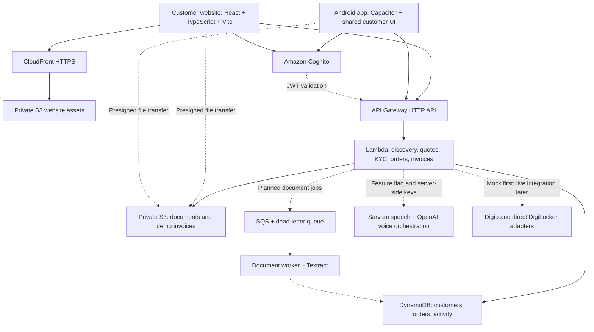
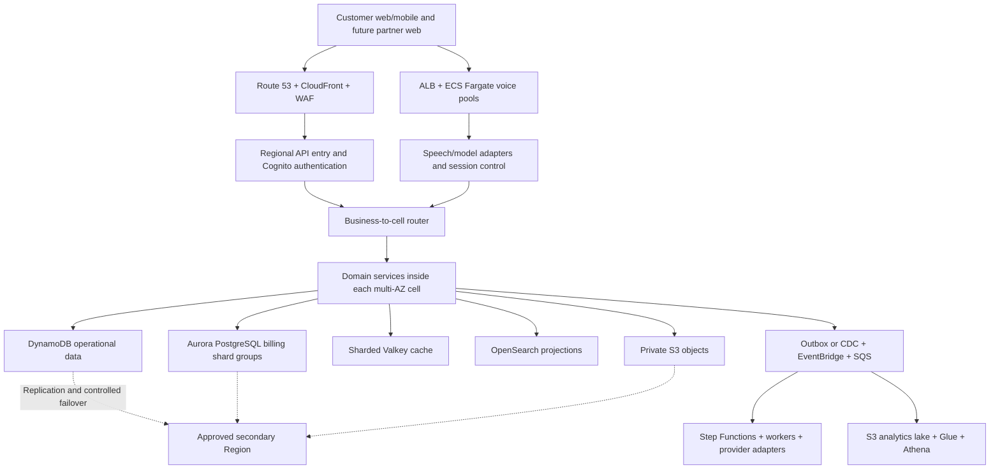

# Accel Telecom

Customer onboarding, plan discovery, smart KYC, order tracking, and one consolidated invoice view for business services.

We are building a customer website and an Android app from a shared React/TypeScript interface, backed by AWS. The partner application is deferred to a later phase.

**Current status — 6 November 2026:** core AWS resources have been provisioned manually through the console. The deployed website and Lambda are infrastructure placeholders. The customer prototype now runs locally on web, with a generated Capacitor Android project. Business APIs and live provider integrations still need implementation. See [customer app setup](apps/customer/README.md).

## Architecture decisions

| Area | Direction |
| --- | --- |
| Customer interfaces | Responsive React website plus a Capacitor Android package, sharing UI and business contracts |
| Hosting | AWS only: private S3 website bucket and CloudFront HTTPS; use the existing CloudFront domain |
| Backend | Modular TypeScript service deployed to Node.js 24 Lambda through API Gateway HTTP API |
| Identity | Cognito user pool; public web/mobile clients; authorization code flow with PKCE |
| Database | Three on-demand DynamoDB tables for customers, orders/invoices, and activity |
| Files | Separate private S3 document bucket; backend-authorized presigned uploads/downloads |
| Recommendations | Questionnaire first; deterministic eligibility, dependency, quantity, and pricing rules on the server |
| Voice | Full Sarvam speech + OpenAI orchestration adapter planned; disabled by default until credentials and integration are ready |
| Voice demo budget | Aim for 4–5 real browser voice sessions; outbound telephone calls remain “Coming soon” |
| KYC | Offer both Digio and direct DigiLocker paths; begin with clearly labelled mock/sandbox adapters |
| Tracking | Persist service-level status and an event timeline; customer tracking uses paginated API reads |
| Invoices | Consolidated customer view across services; versioned demo invoice snapshots and PDF files in S3 |
| Partner workspace | Future web app using the same domain APIs and explicit partner permissions |

AWS-only refers to our hosting and infrastructure. Sarvam, OpenAI, Digio, DigiLocker, and future operator/payment integrations are external provider APIs.

## Prototype architecture



The diagram is the implementation target. The UI, business handlers, voice/KYC adapters, SQS, document worker, and Textract workflow are not implemented or provisioned yet. See [the AWS handoff](infra-placeholder/README.md) for the verified boundary.

The prototype uses request-based services. EC2 servers, NAT gateways, RDS, cache clusters, search clusters, and persistent voice containers are outside the current deployment.

## Production direction: 1 million+ active users

The production design uses independently operated application cells across multiple Availability Zones. Each business has a stable home cell. Cells own their data and queues, with capacity and failure boundaries.



| Layer | Production scaling plan |
| --- | --- |
| Routing | Stable business-to-cell assignments; controlled migrations and independent cell limits |
| Operational data | Distributed partition keys, access-pattern indexes, sparse task indexes, and write sharding for hot queues |
| Billing | Application-routed Aurora shard groups by billing account; date partitions and query-specific indexes within each shard |
| Voice | Fargate pools sized by concurrent sessions, with provider throughput reservations and admission control |
| Cache/search | Valkey cluster sharding; OpenSearch rollover, replicas, and rebuildable projections |
| Background work | Domain queues, bounded consumers, retries, dead-letter queues, and durable workflows |
| Recovery | Multi-AZ operation plus coordinated application/data/identity recovery in a supported secondary Region |
| Delivery | Infrastructure as code, staged cell deployments, observability, restore exercises, and measured load tests |

This is a production design, not deployed infrastructure or a demonstrated capacity claim. The [detailed architecture](docs/architecture.md) includes sizing assumptions, data keys, sharding, indexing, consistency, and recovery tradeoffs.

## AWS deployment configuration

The prototype uses Mumbai (ap-south-1), CloudFront, private S3, API Gateway HTTP API, Lambda, Cognito and three DynamoDB tables. See [the example configuration](infra-placeholder/aws-prototype-config.example.json) for the required shape. All deployment-specific identifiers and resource names are represented by `YOUR_*` placeholders. Replace them with values from ignored local configuration before use.

Verified through console tests: website HTTPS, API health, rejection of anonymous protected requests, and temporary storage write/read/delete checks. Signed-in requests, browser uploads, and application ownership checks still need integration tests.

Use [.env.example](.env.example) as a public template and store actual local values in ignored .env.local. Browser builds necessarily expose the API URL and public Cognito client configuration; credentials and server-only settings must never be embedded in frontend code.

## Repository contents

```text
README.md
.env.example
docs/
  architecture.md                 Detailed prototype and production design
  implementation-plan.md          Development order and two-person ownership
infra-placeholder/
  README.md                       Provisioning handoff and verification status
  aws-prototype-config.example.json  Public configuration template
  index.html                      Website hosting test page
  api/
    index.mjs                     Tested Lambda health/storage diagnostic
    documents-cors.json           Private document-bucket browser configuration
case_source/
  Airtel_SYNC_Case.pdf            Original problem statement
  Submission Template_Sync.pptx   Original submission template
  README.md                      Original synthetic-dataset guide
  *.csv                          Catalogue, leads, GSTIN and Udyam registries
shared/data/
  README.md                      Prepared-data provenance and usage
  *.json                         Catalogue, mock registries, historical summary
fixtures/kyc_documents/           47 supplied synthetic document images
reference/initial-scaffold/       Incomplete earlier package/build configuration
```

Run the customer app with `npm ci` followed by `npm run dev` from the repository root. The earlier scaffold references source files that were never built, so it is preserved under [reference/initial-scaffold](reference/initial-scaffold/README.md). Treat its dependency versions and commands as an unvalidated draft.

## How to use the current files

Preview the static infrastructure page from the repository root:

```bash
python3 -m http.server 5173 --directory infra-placeholder
```

Open `http://localhost:5173/`. This previews the hosting test page only.

Check the Lambda placeholder's syntax:

```bash
node --check infra-placeholder/api/index.mjs
```

For AWS testing, copy that file into the existing Lambda's `index.mjs` and deploy. The private Lambda test event is:

```json
{"operation":"storage-check"}
```

It performs reversible test writes/reads/deletes. Normal HTTP API events cannot select this diagnostic branch. Do not add a public storage-check route.

The customer build loads ignored root `.env.local` configuration based on [.env.example](.env.example). API keys remain blank and server-side; all `VITE_*` settings are public build configuration.

## Data and demo boundaries

The supplied pack contains 25 products, 5,000 fictional leads, 3,534 mock GSTIN entries, 2,723 mock Udyam entries, and 47 specimen KYC images for 12 applicants.

The original dataset guide describes a fixed fixture date and intentionally fictional identifiers. Those are case-data conventions, not live-service rules or a replacement for the actual current date. Keep fixture validation isolated from live provider checks. The prepared catalogue represents fictional case products, not current Accel Telecom tariffs.

Recommendations must use server-side rules and versioned quotes. Voice can collect requirements and explain results; it must use the same eligibility and pricing service as the questionnaire. Invoice PDFs are demonstration documents until connected to an authoritative billing system.

## Next development steps

1. Implement the authoritative TypeScript backend behind the working customer prototype.
2. Implement Cognito callback handling, PKCE, access-token requests, refresh, logout, and ownership checks.
3. Enforce the shared catalogue rules and versioned quotes on the server.
4. Connect private uploads and both KYC provider adapters to the existing mock UI.
5. Persist orders, service-level tracking and consolidated invoice snapshots behind the current customer screens.
6. Add the asynchronous document worker and Textract infrastructure.
7. Integrate browser voice behind disabled-by-default UI/backend flags, then enable only for limited credential-backed demos.
8. Package Android with Capacitor; configure its separate public Cognito client and platform callback.
9. Run the complete customer journey on web and Android.

Nikunj owns AWS and backend/integration work; the teammate owns the shared customer UI and Android delivery. The [implementation plan](docs/implementation-plan.md) describes the 50/50 effort target and integration checkpoints.

## References

- [Capacitor documentation](https://capacitorjs.com/docs)
- [CloudFront private S3 origins](https://docs.aws.amazon.com/AmazonCloudFront/latest/DeveloperGuide/private-content-restricting-access-to-s3.html)
- [API Gateway JWT authorizers](https://docs.aws.amazon.com/apigateway/latest/developerguide/http-api-jwt-authorizer.html)
- [DynamoDB data modelling](https://docs.aws.amazon.com/amazondynamodb/latest/developerguide/data-modeling-blocks.html)
- [AWS cell design](https://docs.aws.amazon.com/wellarchitected/latest/reducing-scope-of-impact-with-cell-based-architecture/cell-design.html)
