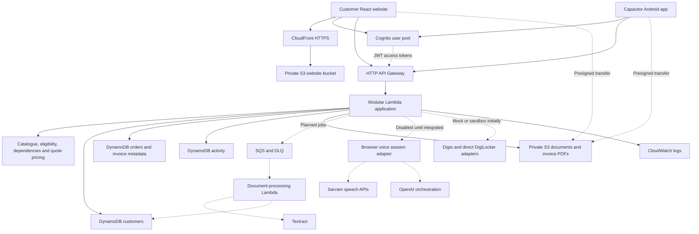
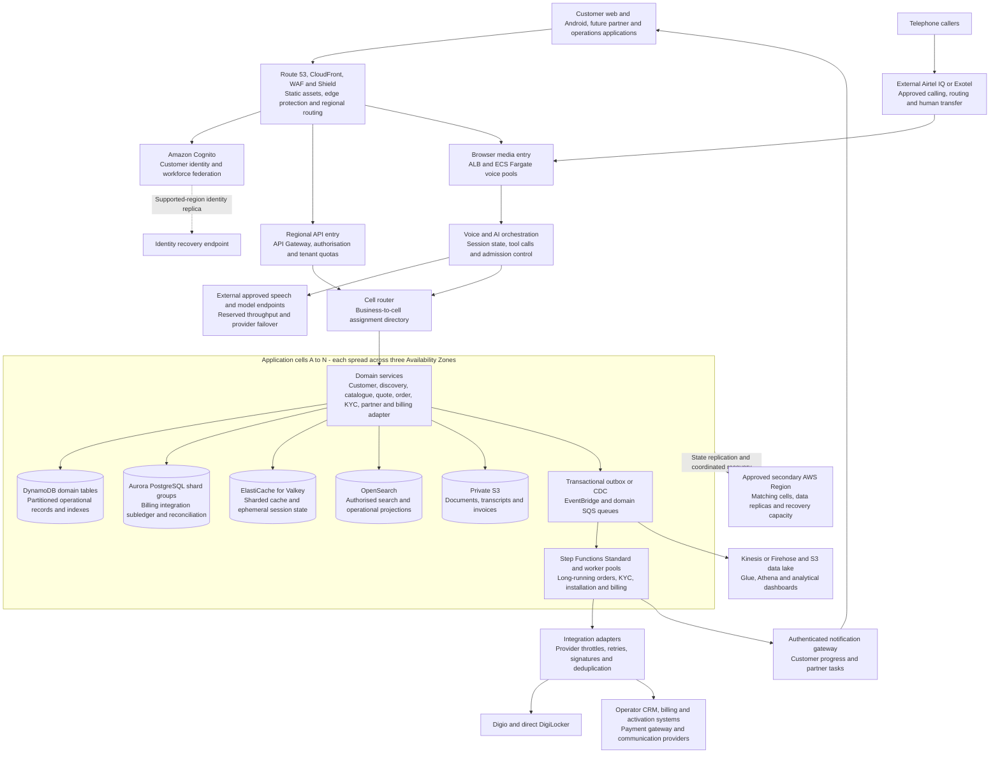

# Airtel Sync — project architecture

Updated 6 November 2026. The prototype's core AWS resources are provisioned and diagnostic-tested. Application features and the production topology below are design targets.

Current delivery: a responsive customer website and an Android package sharing the customer React interface. The partner web app is deferred. The future production design includes customer, partner, review, and operational experiences.

## 1. Prototype

### 1.1 Delivery and stack

| Component | Choice |
| --- | --- |
| Customer UI | React, TypeScript, Vite, responsive CSS/components |
| Android | Capacitor wrapping the customer build; Android Studio/Gradle packaging |
| Client state/forms | TanStack Query, React Hook Form, Zod schemas |
| Authentication | Cognito; oidc-client-ts/react-oidc-context for the web; authorization code + PKCE |
| API | API Gateway HTTP API, JWT authorizer, Node.js 24 TypeScript Lambda handlers |
| Domain logic | Shared typed contracts; server-authoritative catalogue, pricing, order, KYC, and invoice modules |
| Data | Three on-demand DynamoDB tables; PK and SK are strings |
| Files/PDFs | Private S3, presigned object access, server-generated demo invoice PDFs with pdf-lib |
| Documents | Planned SQS job queue and DLQ, Lambda worker, Textract, validation adapters |
| Voice | Planned Sarvam STT/TTS + OpenAI orchestration using short browser turns |
| KYC providers | Digio and direct DigiLocker behind separate interchangeable adapters |
| Testing | Vitest for domain/API logic; Playwright for web journeys; Android device/emulator checks |
| Operations | CloudWatch, request throttling, budget alerts, manual AWS-console provisioning initially |
| Repeatable infrastructure | CDK later, after importing/adopting the existing resources |

These are intended tools, not an installed or validated dependency manifest. The archived initial package draft is not the current runnable app.

### 1.2 Prototype topology

Only the AWS website/API/auth/storage foundation and diagnostic code have been exercised. Dashed components and flows are planned integrations. Provider integrations never run in the browser with server credentials.

### 1.3 Customer journey and boundaries

1. Sign up/sign in with verified email.
2. Capture business requirements through the default questionnaire.
3. Calculate eligible plans and product dependencies using the versioned catalogue. The server chooses explicit demo prices from case inputs and calculates integer-paise totals.
4. Present a quote snapshot with recurring and setup charges, dependencies, and quantities. Revalidate before accepting it.
5. Offer both Digio and DigiLocker KYC paths. Mock mode clearly identifies the provider simulation and mock registry result.
6. Upload documents to private S3 through short-lived object-specific URLs.
7. Create an order and persist service-level status, installation expectations, and activity.
8. Show one consolidated invoice view for the billing account across services, with immutable demo invoice snapshots and downloadable PDFs.

Direct DigiLocker is a consented document-retrieval path; the application must still run the checks required by its KYC workflow. The production operator/billing provider remains the source of statutory billing truth. Prototype PDF documents and mock registry results are labelled as demonstrations.

### 1.4 Authentication and customer ownership

Use the existing Cognito pool and current web client from ignored local deployment configuration; infra-placeholder/aws-prototype-config.example.json documents the shape with placeholders. The issuer is the cognito-idp URL, not the hosted login domain.

- Keep GET /health public.
- Protect GET /auth-check and future customer routes with the JWT authorizer.
- Require an access-token scope on protected routes; email is the current diagnostic scope. Introduce explicit application scopes as the domain API evolves.
- Resolve the customer/business from verified identity and stored membership. Do not accept ownership merely from a body/path customer ID.
- Check object, order, invoice, and document ownership on every request.
- Use authorization code + PKCE and validate the callback state. Add local-development callback URLs deliberately.
- Give Android its own public app client and platform return URI while sharing the same user pool. Use the system browser and platform-appropriate secure token storage.

Signed-in success, refresh, logout, and persisted scope enforcement are still untested. Anonymous denial alone does not validate the complete authentication flow.

### 1.5 Operational data model

All three existing tables have string PK/SK keys. The item patterns below are a proposed application contract; no business records or secondary indexes have been created.

| Table | Proposed records and queries |
| --- | --- |
| Customers | PK CUSTOMER#sub; SK PROFILE, DISCOVERY#id, KYC#id, or membership/site records as requirements expand |
| Orders | PK ORDER#id with META and SERVICE#id items; independent INVOICE#id partitions for consolidated invoice snapshots |
| Activity | PK ORDER#id; SK EVENT#timestamp#id; store aggregate version for authoritative transition ordering |

Add a sparse customer-history GSI on the orders table when implementing list views: GSI1PK CUSTOMER#sub; GSI1SK ORDER#timestamp#id for order metadata and INVOICE#timestamp#id for invoice metadata. Query the desired prefix with pagination. The GSI is planned, not deployed.

Every service state update validates the current order version. Use conditional writes and DynamoDB transactions where related records must change atomically. Use idempotency keys for quote acceptance, order creation, invoice creation, and provider callbacks. Store large files in S3 and small references in DynamoDB.

No customer dashboard should repeatedly scan all tables. A future partner task projection gets a separate sparse index or domain table; do not build the deferred partner UI now.

### 1.6 Voice and feature flags

The architecture includes the complete voice path, although the initial experience is questionnaire-first:

- The browser/mobile interface captures a short speech turn.
- The backend adapter performs speech recognition, requirement extraction, validated domain-tool calls, and response synthesis.
- Sarvam provides the speech path; OpenAI supplies the agreed generative orchestration.
- Extracted requirements feed exactly the same server-side recommendation and quote rules as questionnaire answers.
- Typed fallback remains available if microphone permission, latency, or a provider fails.

Default both VOICE_ENABLED and VITE_VOICE_ENABLED to false. The backend must also validate configured credentials and enforce admission limits before enabling a session. Expose only non-secret capabilities to the UI. Aim for 4–5 real prototype sessions; telephone outbound calls remain “Coming soon.”

No live voice integration, provider keys, or usage-control implementation exists yet.

### 1.7 KYC, documents, and invoices

KYC_MODE defaults to mock. Keep Digio and DigiLocker as distinct options and distinct provider adapters with common application status/output types.

The planned document workflow uses a private upload, a durable job, a worker, Textract extraction, field/registry checks, and persisted processing results. Add retries, a dead-letter queue, duplicate-event handling, and file type/size validation. Those AWS components are still pending.

Consolidate invoices at billing-account/period scope so one view can include services activated by different orders. Retain the quote/catalogue version, line-item basis, activation dates, tax assumptions, and rounding decisions. Use integer paise. Never recalculate an already issued snapshot from changed catalogue prices.

### 1.8 Deployment and cost controls

Regional resources are in Mumbai. CloudFront serves public application assets; the document bucket remains private with block-public-access enabled. Use the CloudFront-provided and execute-api domains for the prototype.

The user chose AWS-managed service permissions for prototype provisioning after console compatibility problems. The runtime role currently has AmazonDynamoDBFullAccess, AmazonS3FullAccess, and its inline log policy. This is the recorded prototype setup. Production permission design is separate.

Keep seven-day log retention, low API throttling targets, voice disabled, and a monthly email budget alert. Confirm those console settings; a budget alert is not a spending cap. No always-on SQL, cache, search, voice pool, NAT gateway, or load balancer is part of the prototype.

The repo contains no deployable CDK stack. Codify the existing deployment later through imports/adoption, not by blindly creating duplicate resources.

## 2. Production sizing assumptions

The following are capacity-planning assumptions, not forecasts or guarantees. “One million active users” is interpreted conservatively as one million daily active users. Service capacity is validated against requests, calls, records and third-party quotas rather than user count alone.

| Workload | Initial planning target |
| --- | --- |
| Daily active users | 1 million, with room to add application cells |
| Dynamic requests | 40 million/day at 40 requests per daily active user |
| Mean request rate | Approximately 463 requests/second |
| Peak dynamic request target | 10,000 requests/second; test short bursts at 20,000 |
| Concurrent web sessions | 50,000 sessions; not all issue requests simultaneously |
| Concurrent voice sessions | 5,000 across independently scaled voice pools |
| Voice turn demand | At one turn per eight seconds, approximately 625 model turns/second |
| Four-minute calls at steady concurrency | Approximately 21 new calls/second |
| Core API availability objective | 99.95%, with third-party dependencies measured separately |
| Core API latency objectives | P95 reads under 300 ms and writes under 500 ms, excluding external provider waits |
| Initial regional recovery objectives | RTO within 30 minutes; critical-state RPO within one minute, subject to replication and recovery testing |

Voice capacity requires contracted telephony channels and speech/model throughput, not just more application containers. Maintain separate quotas and SLOs for voice, web, billing, document processing and operator activation.

## 3. Production high-level architecture

The diagram expands one representative cell. Other cells have independently allocated application compute, operational data, queues, caches and limits. Regional edge routing and identity are shared dependencies and need their own high-availability design. Billing shard groups are assigned to cells; no shared global billing writer sits underneath every cell.

## 4. Partitioning, sharding and indexing

### Application cells

- Route each business and all its sites to a stable cell assignment. Keep a cached directory; directory failure must not require a fresh central lookup for every established request.
- Add cells when measured capacity or isolation requirements justify them. A large partner's portfolio can span cells; its dashboard uses paginated read projections rather than synchronous requests to every cell.
- Isolate high-volume tenants in dedicated cells when necessary. Prevent one partner, tenant or campaign from exhausting the region's shared concurrency.
- Move businesses through a controlled migration: copy, catch up changes, verify, fence writes, update routing, and retain redirects. Do not change a simple hash modulus and inadvertently remap the entire population.

### Operational data: DynamoDB

| Access pattern | Proposed key/index approach |
| --- | --- |
| Business profile | Partition by business ID; site-specific records under explicit site keys |
| Application/order detail | Partition by application/order ID; related items use ordered sort-key prefixes |
| Customer's applications/orders | Business-scoped index sorted by created time and ID |
| Partner's open tasks | Sparse index keyed by partner, status and due-time bucket; add bounded hash buckets for demonstrably hot queues |
| Regional unassigned task queue | Partition by region, task type, date bucket and hash shard |
| Application activity | Partition by application/order; time buckets for very large histories |
| Idempotency and processed events | Unique operation/event ID, scoped to the owning business and operation |

- DynamoDB physically partitions data, but the application must distribute traffic across base-table and index keys. Avoid a global `OPEN` or `PENDING` partition key.
- Use calculated write sharding for concentrated ingestion and high-volume queues. Consumers query a bounded number of buckets, merge and paginate; arbitrary fan-out is not a free operation.
- GSIs are read projections. Task assignment, order transition and payment state changes validate the authoritative record with conditional/versioned writes.
- Do not rely on TTL expiry as an exact scheduling or lock-release mechanism. Check expiry values in business logic.
- Keep documents and large transcripts in S3; retain references and small metadata in DynamoDB.

### Financial data: Aurora PostgreSQL

- The operator's billing platform remains authoritative for statutory invoices and balances. The application subledger tracks allocations, integration state, reconciliation and the consolidated customer view.
- Route by billing-account ID through a stable shard directory. All services for one billing account stay in the same shard group so one bill does not require a cross-shard transaction.
- Each shard group has a writer and failover/read replicas across Availability Zones, pooled connections and independently managed capacity.
- Use date-range partitions for large ledger/event/history tables where query and retention patterns justify them. Table partitioning is not horizontal writer scaling; multiple shard groups provide that scaling.
- Use account-and-date B-tree indexes for invoice history, partial indexes for open reconciliation work and BRIN indexes only for suitably ordered append-heavy timestamp data.
- Enforce provider-event deduplication and invoice uniqueness at the correct scope. PostgreSQL partitioned unique constraints must include partition keys; use an unpartitioned identity registry within a shard where needed to enforce identities across time partitions.
- Invoice and ledger writes commit atomically with an outbox. Cross-shard settlements use explicit workflows and reconciliation rather than pretending to be one distributed SQL transaction.
- Use replicas for lag-tolerant reads. Read critical payment/approval results from the authoritative writer path.

### Search, caching and analytics

- OpenSearch stores derived, rebuildable search projections, with business/partner access filters. Size shards by indexed volume and workload, use rollover and replicas; do not create an index per small customer.
- Valkey uses cluster-mode sharding and multi-AZ replicas. Cache public catalogue data and versioned reference data; keep financial truth in durable stores. Hot-key protection includes request coalescing, bounded local caching and jittered expiry.
- Feed the S3 analytical lake through durable change/event pipelines. Partition analytical data by domain and date, compact small files, and query with Athena. Heavy funnel analysis does not scan live operational databases.

## 5. Scaling beyond the database

| Layer | Scaling and protection |
| --- | --- |
| Web delivery | CDN caching for public assets, immutable hashed builds, cache invalidation only where necessary; authenticated data excluded from public caches |
| API compute | Stateless domain services; Lambda reserved concurrency or ECS autoscaling by service; scheduled headroom before campaigns; quota increases before load arrives |
| Voice media | Long-lived connections on Fargate pools; scale by concurrent sessions, event-loop delay, memory and model latency; drain calls during deployments |
| AI providers | Reserved external throughput, per-language and per-tenant quotas, token/context limits, measured fallback quality and admission control |
| Queues | Separate KYC, installation, billing and notification queues; bounded consumer concurrency; age-of-oldest-message alarms and dead-letter queues |
| Ordering | Direct SQS FIFO paths where entity-level ordering matters, grouped by order/account; include aggregate version checks even when queues preserve order |
| Workflows | Step Functions Standard for long waits and human approvals; persist business state separately so workflows can be reconstructed |
| Documents | Direct-to-S3 uploads, quarantine and malware checks, asynchronous OCR, file-size/type limits, lifecycle policies and controlled downloads |
| Notifications | Business-scoped subscriptions and paginated updates; send changed records rather than broadcasting to every connection |
| Batch billing | Distribute jobs by account shard and billing date with a completion watermark; avoid one midnight job for all customers |
| External integrations | Provider-specific pools, rate limits, deadlines, circuit breakers and callback reconciliation; one failed provider must not stall all orders |
| Analytics | Independent ingestion/query capacity; dashboards read aggregates and projections instead of fan-out operational scans |

## 6. Consistency and workflows

Example order workflow: accepted quote -> prerequisite KYC -> payment authorisation as required -> serviceability/installation -> individual product activation -> billing handoff -> customer confirmation.

- Model activation separately for each product. One order can be partially active while other services are pending.
- Use an outbox or CDC to couple committed state with downstream events. Consumers must safely handle repeated delivery and out-of-order callbacks.
- Assign idempotency keys to checkout, provider submission, payment capture, invoice generation and installation requests. Confirm unknown outcomes with providers before retrying a non-reversible operation.
- Keep per-order/account sequence numbers and reject invalid or stale state transitions. Standard workflow execution semantics do not guarantee that a third party receives a side effect exactly once.
- Use compensation where appropriate, such as releasing a payment authorisation or cancelling an unfulfilled service. Financial corrections use explicit reversal/credit records.
- Partner task claims use conditional updates. An AI-generated summary never grants permission to approve KYC or change a financial record.
- Keep high-volume telemetry separate from durable business events. Voice admission can offer a questionnaire or scheduled callback when provider limits are reached.

## 7. Regional resilience and security

- Primary application/data Region: Mumbai. Prefer Hyderabad for Indian operational-data recovery where all required service/version combinations support it.
- Three-AZ deployment within each active Region; size remaining capacity to meet the target during loss of one AZ.
- Replicate operational state with DynamoDB global tables in the selected supported consistency mode; use one home writer Region per business to avoid concurrent mutation conflicts. For eventually consistent replicas, prevent split-brain writes with an ownership epoch and fencing.
- Replicate Aurora shard groups with Aurora Global Database and S3 objects with replication; keep point-in-time recovery and independently protected backups. Cache and search state must be rebuildable.
- Treat a regional switchover as coordinated recovery across routing, identity, writers, workflows, integrations and notifications. Ensure secondary capacity and downstream quotas are available before declaring recovery complete.
- Identity recovery needs separate validation. Cognito MRR requires a supported feature plan, multi-Region customer-managed keys, and supported Regions. Select an approved identity-recovery design; application-data replication alone does not replicate identity.
- Cognito secondary pools have functional limitations, including sign-up and password resets; verify current MFA limitations and test the degraded-mode experience.
- An active telephone call may disconnect during a task or regional failure. Resume from confirmed conversation checkpoints or arrange a callback; do not promise uninterrupted media failover.
- Isolate production, non-production and security/log archives in separate AWS accounts. Use least-privilege roles, tenant/partner access checks, KMS encryption, Secrets Manager, WAF, administrative MFA and auditable changes.
- Retain only necessary documents/audio with recorded consent and lifecycle/deletion handling. Keep identity documents out of general AI prompts. Restrict and audit document access independently from sales access.
- Define and test recovery targets per data class. The one-minute RPO is a design objective for critical state, not a guarantee of zero data loss. Reconcile payment and operator records after failover.

## 8. Deployment and production acceptance

- Build with TypeScript, React, AWS CDK, versioned API schemas and backward-compatible event contracts.
- Use canary or blue/green deployment, beginning with one cell. Database changes follow expand/migrate/contract; verify restoration and rollback plans.
- Monitor end-to-end business outcomes: accepted-quote-to-activation, stuck order age, partner task age, payment/invoice reconciliation, KYC completion and call-to-qualified-lead conversion.
- Correlate request ID, business ID, order ID, call ID and provider event ID; do not log raw identity documents or full identifiers.
- Gate launch on load tests at target and burst traffic, hot-key tests, AZ-loss tests, provider-outage tests, duplicate webhook tests, auth failover tests and regional restore exercises.
- Validate all AWS and external quotas: API requests, Lambda concurrency, Fargate capacity, database throughput, workflow starts/transitions, OCR jobs, identity requests, telephony channels and model tokens/audio throughput.

## Sources

- [AWS cell-based architecture guidance](https://docs.aws.amazon.com/solutions/cell-based-architecture-on-aws/)
- [DynamoDB partition key design](https://docs.aws.amazon.com/amazondynamodb/latest/developerguide/bp-partition-key-design.html)
- [DynamoDB modeling building blocks](https://docs.aws.amazon.com/amazondynamodb/latest/developerguide/data-modeling-blocks.html)
- [DynamoDB global tables](https://docs.aws.amazon.com/amazondynamodb/latest/developerguide/GlobalTables.html)
- [PostgreSQL table partitioning](https://www.postgresql.org/docs/current/ddl-partitioning.html)
- [Aurora Global Database](https://docs.aws.amazon.com/AmazonRDS/latest/AuroraUserGuide/aurora-global-database.html)
- [ECS service autoscaling](https://docs.aws.amazon.com/AmazonECS/latest/developerguide/service-auto-scaling.html)
- [Step Functions workflow types](https://docs.aws.amazon.com/step-functions/latest/dg/choosing-workflow-type.html)
- [Transactional outbox pattern](https://docs.aws.amazon.com/prescriptive-guidance/latest/cloud-design-patterns/transactional-outbox.html)
- [OpenSearch shard sizing](https://docs.aws.amazon.com/opensearch-service/latest/developerguide/bp-sharding.html)
- [Cognito multi-Region replication](https://docs.aws.amazon.com/cognito/latest/developerguide/user-pool-multi-region.html)

The current prototype does not implement this production topology. Adopt these mechanisms against measured load, isolation requirements, provider limits, and the production acceptance criteria above.
