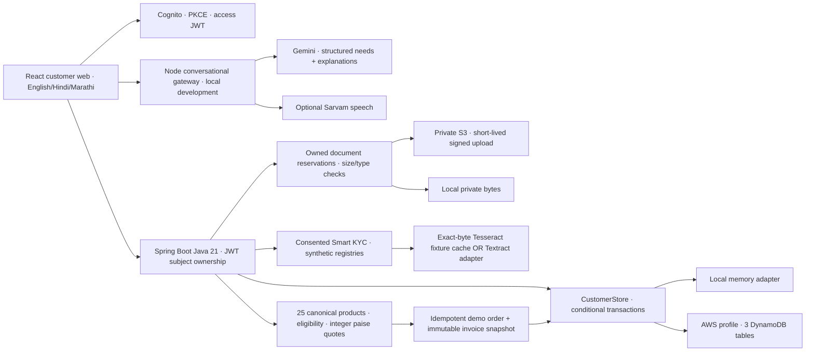

# Accel Telecom / Airtel SYNC architecture

Updated 7 November 2026. This describes implemented code. The configured public API still runs the infrastructure diagnostic service, not this backend; see [AWS readiness](case-assessment/AWS_READINESS.md).

## Customer flows

1. Local demo stores fictional workspace metadata on the device. Cloud configuration enables Cognito sign-in and authoritative APIs. API errors stay errors; they do not seed or fall back to a demo account. Native cloud sign-in still needs its own public client and system-browser return handling.
2. Questionnaire and optional typed/voice GenAI discover business needs, existing tools, budget, size and sites. GenAI proposes only catalogue IDs and confirmed quantities; the server computes the checkout quote. Optional add-ons are ordinary editable cart lines with dependency/eligibility checks. Monthly recurring amount, illustrative tax, setup charges, contract and expected installation are shown separately.
3. Private upload authorization reserves an owned key and enforces quotas. Completion verifies bytes/metadata; changes revoke KYC consent and approval. Explicit consent permits OCR and synthetic registry checks. Reports mask identifiers and explain review issues. Cached OCR recognizes only supplied specimen bytes. Textract is a selectable adapter, not a verified live connection.
4. Demo verification requires passing document checks and an explicit server demo gate. Checkout transactionally creates an order, invoice snapshot, notice and idempotency record. Orders expose their status/timeline. There is no production provisioning or payment provider.
5. Tickets, resolution and read notices persist under the authenticated subject. Unsupported live service changes, payments, appointment mutation and manual milestone simulation stay disabled in API mode.

## Boundaries and deployment

Spring uses AWS SDK credential discovery and the Lambda execution role; AWS secrets do not go in Vite configuration. `SPRING_PROFILES_ACTIVE=aws` requires DynamoDB/S3 adapters, never silent memory fallback. Tables use string `PK`/`SK`; ownership is `CUSTOMER#<JWT sub>`. Conditional versions protect concurrent edits and checkout. S3 keys are server-generated. APIs never expose raw storage keys or bulk registries.

The regular Dockerfile runs an HTTP container. `Dockerfile.lambda` includes AWS Lambda Web Adapter and a `/health` readiness check. Building/deploying it, wiring API Gateway routes, applying IAM, bucket CORS/lifecycle and replacing the hosted customer build remain deployment work. The Node advisor currently binds loopback with exact-origin checks, bounded requests/sessions and provider quotas; an authenticated, throttled hosted gateway is required before enabling it publicly. No public production chat endpoint is provisioned by this task.

Invoice PDFs are generated on the client from saved server invoice snapshots, with an embedded Devanagari font. No invoice PDF objects are stored in S3 by the current application. The partner backoffice, real provider callbacks/e-sign, payment collection and actual telecom activation are separate future integrations.

## Verification

Unit/domain tests, authenticated Spring API tests and real React–Spring browser tests exercise ownership, pagination, failure handling, KYC, checkout and invoice snapshots. Browser tests cover desktop/mobile layouts, voice mocks, typed advisor mocks and Hindi/Marathi controls. Case-data analysis and specimen OCR checks are reproducible scripts/tests; [case assessment](case-assessment/README.md) records evidence and limitations.
