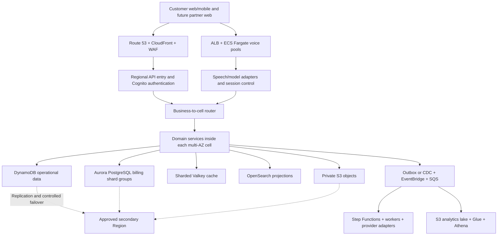

# Future production design

This is an unimplemented design discussion, separate from the current case prototype.

## Production direction: 1 million+ active users

The production design uses independently operated application cells across multiple Availability Zones. Each business has a stable home cell. Cells own their data and queues, with capacity and failure boundaries.

| Layer | Production scaling plan |
| --- | --- |
| Routing | Stable business-to-cell assignments; controlled migrations and independent cell limits |
| Operational data | Distributed partition keys, access-pattern indexes, sparse task indexes, and write sharding for hot queues |
| Billing | Application-routed Aurora shard groups by billing account; date partitions and query-specific indexes within each shard |
| Voice | Fargate pools sized by concurrent sessions, with provider throughput reservations and admission control |
| Cache/search | Valkey cluster sharding; OpenSearch rollover, replicas, and rebuildable projections |
| Background work | Domain queues, bounded consumers, retries, dead-letter queues, and durable workflows |
| Recovery | Multi-AZ operation plus coordinated application/data/identity recovery in a supported secondary Region |
| Delivery | Infrastructure as code, staged cell deployments, observability, restore exercises, and measured load tests |

This is a production design, not deployed infrastructure or a demonstrated capacity claim. The [detailed architecture](docs/architecture.md) includes sizing assumptions, data keys, sharding, indexing, consistency, and recovery tradeoffs.

